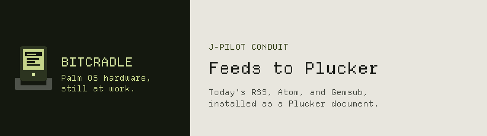
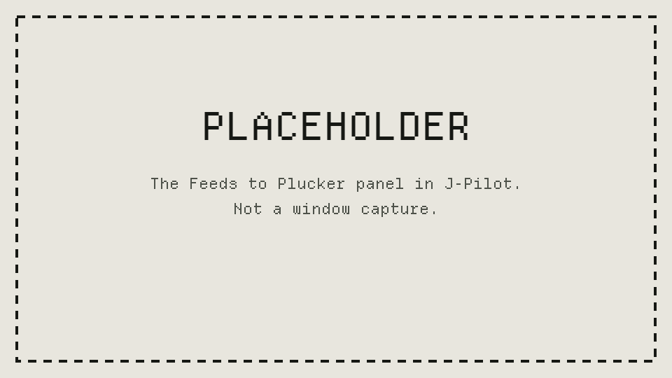

# Feeds to Plucker

[](brand/README.md)
[](brand/README.md)
[](brand/README.md)
[](LICENSE)



During HotSync, Feeds to Plucker collects today's RSS, Atom, and Gemsub articles on the desktop and installs them as one Plucker document for offline reading.

A [Bitcradle](brand/README.md) project. Palm OS hardware, still at work.

## Pitch

The conduit is a J-Pilot plugin. You give it feed URLs. On each HotSync the desktop fetches articles dated today, builds a Plucker file with a linked table of contents, and installs that file into the handheld's internal memory. You open **J-Pilot RSS Today** in the Plucker viewer and read it with the cable unplugged.

The running conduit does not call a language model. Feed text comes from the feed, from a plain extraction of the linked page, or from the summary. A model was used to write the program. That is covered under [How this was made](#how-this-was-made).

## Screenshots

No J-Pilot window capture and no handheld photograph are checked in. The frames below are placeholders. The picture on the social preview is a diagram of the edition, with that caption baked into the image.



> **Placeholder.** The J-Pilot panel (**Plugins → Feeds to Plucker**) belongs here. This is not a capture.


> **Placeholder.** A photograph of **J-Pilot RSS Today** open in Plucker belongs here. The sync below was done on a real Tungsten T3. This frame is not that photograph.

A short GIF of a HotSync belongs with those captures once one exists.

## Features

- J-Pilot plugin named **Feeds to Plucker** (version string **Feeds to Plucker 1.0**).
- Subscribe, remove, import, and export feeds. The list is saved as soon as you change it.
- HTTP and HTTPS feeds in RSS, Atom, and RSS 1.0 (RDF).
- Gemini subscription pages (`gemini://`). A Gemsub link is included when its label begins with today's `YYYY-MM-DD` and the next character is not a letter or digit. The rest of the label is the title.
- One edition per successful HotSync, installed under the reserved database name **J-Pilot RSS Today**.
- A linked table of contents, 100 articles per page, with previous and next page links.
- Full text from the feed (`content:encoded` or Atom `content`) when the feed supplies it. Otherwise the helper fetches the linked page and extracts readable text, preferring an `article` region, then `main`, then paragraphs. The feed summary is the last resort.
- JPEG, PNG, GIF, and WebP images, including Gemtext links with those extensions. Images are scaled down to fit inside 160×160 (smaller images stay smaller), converted to greyscale, and dithered with Floyd–Steinberg to one bit. Repeated image URLs share one bitmap.
- OPML import and export for HTTP and HTTPS feeds.
- A desktop preview that writes the same kind of Plucker file without a handheld attached.

## Supported devices

**Tested.** A Palm Tungsten T3, syncing from an Omarchy Linux desktop. The T3 runs Palm OS. The Palm OS version and the Plucker build on that device were not written down with the test.

**Desktop.** A Unix machine running a GTK 3 build of J-Pilot with plugin support, plus the libraries under [Install](#install). The helper uses `signal.alarm`, so it expects a Unix-style desktop. Python 3.9 or later is required at sync time. Image conversion calls ImageMagick 7 (`magick`). Without `magick`, articles still sync and the alt text is kept when an image cannot be converted. Omarchy Linux is the desktop this has been synced from.

**Handheld.** A Palm OS device that can store a Plucker document in internal memory and open it in the Plucker viewer. The Tungsten T3 is one of those devices. Its screen is 320×480. Images in the edition are still prepared for a 160×160 one-bit screen, which is the classic Palm OS display, and the conduit does not write hi-res image records. Text is ordinary Plucker text in Latin-1. The T3 test used that standard document.

Other models are not listed here. They have not been part of a recorded sync.

Plucker project files: [SourceForge](https://sourceforge.net/projects/plucker/).

## Install

### Build

You need a C compiler, make, pkg-config, and the development files for GTK 3, libxml2, and pilot-link (`libpisock`). GTK 3 here has to be built against GLib 2.70 or later. The plugin calls `g_uri_parse` (GLib 2.66) and `g_spawn_check_wait_status` (GLib 2.70), so 2.70 is the floor.

Ubuntu 24.04's default archive does not ship `libpisock-dev`. J-Pilot's maintainer publishes `libpisock-dev`, `libpisock9`, `libpisync1`, and `pilot-link` 0.15.0-2, including builds for Ubuntu noble, from the [judd/jpilot packagecloud repository](https://packagecloud.io/judd/jpilot). That page has the repository install steps. Upstream source is [pilot-link](https://github.com/desrod/pilot-link).

```sh
make
make install
```

`make install` copies `libjpilot-rss-plucker.so` and `rss_plucker.py` into the active J-Pilot profile's `plugins` directory. The profile is `$JPILOT_HOME/.jpilot` when `JPILOT_HOME` is set, and `~/.jpilot` otherwise. Override it with `PROFILE=/path/to/.jpilot`. Restart J-Pilot after installing.

The plugin is linked to GTK 3, libxml2, and libpisock, so those shared libraries are also needed at runtime, along with Python 3.9 or later on `PATH`.

### Runtime files

| Path in the J-Pilot profile | Role |
| --- | --- |
| `plugins/libjpilot-rss-plucker.so` | The plugin |
| `plugins/rss_plucker.py` | The helper J-Pilot runs during HotSync |
| `rss-plucker-feeds.txt` | One feed URL per line |
| `rss-plucker-gemini-pins/` | Gemini trust-on-first-use certificate fingerprints |

Generated databases use a temporary file during sync and are removed afterward. A preview you run yourself is written where you tell it to go.

## Usage

1. Install the Plucker viewer on the Palm. The project files are on [SourceForge](https://sourceforge.net/projects/plucker/).
2. In J-Pilot, open **Plugins → Feeds to Plucker**. Add feed URLs. For Gemsub, enter the `gemini://` URL of the subscription page. The status line confirms the save. **Import OPML** appends new HTTP and HTTPS feed URLs from the file, including feeds nested in folders, and skips duplicates. **Export OPML** writes only the HTTP and HTTPS subscriptions, in list order, using each URL as its title. Folder names and feed titles are not stored. Gemini URLs stay in the subscription list and are left out of the OPML file.
3. HotSync as you usually do. On the handheld, open **J-Pilot RSS Today** in Plucker and tap a headline.

The desktop's local calendar date at the start of the fetch decides which articles are included. Entries without a usable publication date are skipped. For RSS and Atom the helper understands ISO-8601 dates and RFC 822 `pubDate` values (`pubDate`, `published`, `date`, `issued`).

Gemini uses trust on first use. The first certificate fingerprint for a host and port is stored. A later change is reported as "Gemini certificate changed" and that request fails. When J-Pilot runs the helper, pins are stored in the profile directory next to `rss-plucker-feeds.txt`. When you run the helper yourself, they are stored next to the feeds file you pass in.

Every successful transfer replaces the same database in internal memory (pilot-link card 0). The name **J-Pilot RSS Today** is reserved for this conduit. The file is a Plucker document (Palm database type `Data`, creator `Plkr`). If no feeds are configured, or none of them have an article dated today, the edition contains the line "No articles published today were available at this HotSync." and still replaces the previous edition. An unreachable feed is named by host in the sync log (the full URL is not printed, so a token in a feed URL stays out of the log) and omitted from that edition. A failed sync can leave the previous edition on the device until the next successful transfer.

The helper sends `User-Agent: J-Pilot-Feeds-to-Plucker/1.0` on HTTP and HTTPS. Responses larger than 4 MiB are refused. Redirects are followed up to six times. Waiting is bounded to about 45 seconds from the start of the helper (`alarm` at 45 seconds, and image fetches stop once a 42-second deadline is close), so a slow feed cannot hold the HotSync open indefinitely.

Duplicate articles collapse to one. The key is the article URL, or the source, title, and timestamp when there is no URL. The edition keeps the newest 500 entries. Long articles are shortened to stay near a 30,000-byte paragraph budget, and the text then ends with "[Article shortened for Palm OS.]". Palm's Latin-1 encoding is what the records store. Curly quotes, en dashes, em dashes, and ellipses are folded to ASCII approximations first. Other characters that Latin-1 cannot hold become question marks.

If an image cannot be converted, or the sync deadline is close, its alt text is used when it has any. Linked contents entries open the article, and converted images are embedded for offline reading.

### Preview without a Palm

From the source directory, pass a UTF-8 text file with one feed URL per line and a path for the generated database:

```sh
python3 rss_plucker.py feeds.txt today.pdb
```

The helper prints `Feeds to Plucker: synced N article(s) for YYYY-MM-DD.` and writes `today.pdb`. An empty feed list is enough for a quick offline check. The file is the same kind of Plucker database a HotSync would install. Opening it still takes the Plucker viewer, on a desktop port or on a handheld. `*.pdb` files are gitignored so a preview does not land in a commit by accident.

Running the helper with the wrong number of arguments prints:

```text
usage: python3 rss_plucker.py FEEDS.txt OUTPUT.pdb
```

## Roadmap

The items below are planned. They are not in the tree yet.

- Write down the Palm OS version and the Plucker build used on the Tungsten T3.
- Keep more than the current calendar day when a device has room for it.
- Optional image records larger than 160×160 for handhelds whose screens can use them.
- A checked-in sample feed so the edition builder can be tested without the network.

## Contributing

See [CONTRIBUTING.md](CONTRIBUTING.md). Bug reports and changes should say whether a handheld was actually in the loop.

## How this was made

Feeds to Plucker was written with OpenAI Codex, using the Astra model, as a coding assistant on the desktop. The program that runs at HotSync does not call a model. Fetching, extraction, dithering, and the Plucker file are ordinary code.

## License

Feeds to Plucker is free software. You can redistribute it and modify it under the terms of the GNU General Public License as published by the Free Software Foundation, either version 2 of the License, or (at your option) any later version. The same terms cover the brand text and artwork in this repository. See [LICENSE](LICENSE). Copyright (C) 2026 Alex White.

The typefaces named in the brand kit are not part of that grant. They stay under their own licenses, and the font files are not bundled here.

## References

- [J-Pilot plugin API](https://www.jpilot.org/documentation/plugin.html)
- [Plucker document format](https://github.com/kovidgoyal/calibre/blob/master/format_docs/pdb/plucker.html) (Calibre's format notes)
- [Plucker project files](https://sourceforge.net/projects/plucker/)
- [pilot-link](https://github.com/desrod/pilot-link)
- [J-Pilot packagecloud builds, including libpisock for Ubuntu](https://packagecloud.io/judd/jpilot)

---

Part of **Bitcradle**. Palm OS hardware, still at work.

Colors, type, and marks: [brand/README.md](brand/README.md). Copy that folder into another Palm OS project to reuse it.
